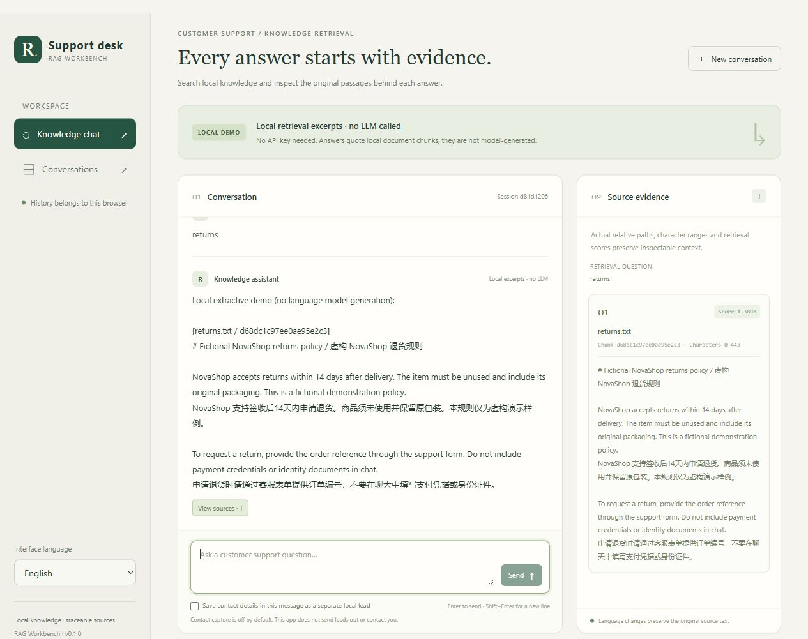

# Django RAG Customer Service

[简体中文](README.zh-CN.md) · English

A bilingual Django workbench for customer-support questions over local text documents.

The default experience is a real, keyless local retrieval demo. It returns **document excerpts, not LLM-generated answers**, together with relative file paths, chunk IDs, character spans and scores. The English / 简体中文 interface includes browser-owned histories, restore/export/delete controls and opt-in local contact capture.



## Run locally

Use Python 3.11 or later. Run these commands from the repository root.

### Windows shortcut: keyless demo

```powershell
.\run.ps1
```

If PowerShell blocks script execution, use this process-scoped invocation:

```powershell
powershell -ExecutionPolicy Bypass -File .\run.ps1
```

The shortcut creates `.venv` if needed, installs the base runtime with `pip install -e .`, runs database migrations, builds the **demo** index and starts the server at [127.0.0.1:8000](http://127.0.0.1:8000/). `-Port` defaults to `8000`; for another port, use `.\run.ps1 -Port 8010`. Installation may download dependencies; the running demo makes no model or network requests. Stop with Ctrl+C.

**This shortcut always selects the keyless demo**, even if a private `.env` selects API mode. It does not install development/API/vector extras. Use the manual setup and optional API instructions below for those paths.

### Manual setup: all platforms

1. Create and activate an environment. In Windows PowerShell:

   ```powershell
   python -m venv .venv
   .\.venv\Scripts\Activate.ps1
   ```

   On macOS / Linux, activate with `source .venv/bin/activate` instead.

2. Install the application and development tools:

   ```powershell
   python -m pip install -e ".[dev]"
   ```

3. Initialize the new local database and build the demo index:

   ```powershell
   python manage.py migrate
   python manage.py build_index
   ```

4. Start the local server:

   ```powershell
   python manage.py runserver 127.0.0.1:8000
   ```

5. Open [the local chat](http://127.0.0.1:8000/). Ask “订单一般多久发货？” or “How do I request a return?” and inspect the source panel. Use **English / 简体中文** in the sidebar to change interface language.

No `.env` file, model download, API key or external service is required for this default flow. `DJANGO_DEBUG` defaults to false; CSS and JavaScript are included in the templates, so the local interface does not depend on development static-file serving, CDNs or external fonts.

The fresh SQLite database, development secret and generated indexes live under `.runtime/`, which is ignored by Git. A fresh local installation starts with no saved conversations. The default local cookie is associated with this browser; clearing cookies can remove access to its old conversations. This is local browser ownership, not an account or a production authentication system.

## Understand the two modes

| | Default `demo` | Optional `openai` |
|---|---|---|
| Retrieval | Local lexical retrieval over actual chunks | LangChain-compatible embeddings and local FAISS similarity search |
| Answer | Explicitly labeled source excerpts | Configured chat provider, when matching evidence exists |
| Network | No model or network requests | Index creation sends document text for embeddings; answering sends the question, bounded context and retrieved text to the configured provider |
| Requirements | Base installation | `vector` and `api` extras; your provider, credentials and models |
| Live provider verification | Not applicable | **Not performed for this integration**; offline mocks do not establish provider compatibility or answer quality |

There is no silent fallback from a failed provider request to a demo answer. No matching source is an explicit no-evidence result. A `grounded` flag indicates whether supporting chunks were retrieved; it is not a proof that an API-generated claim is correct. Retrieval scores are ranking signals and are not calibrated confidence probabilities.

## Documents and configuration

The bundled [sample documents](data/sample_docs/) describe **fictional NovaShop policies** in Chinese and English. They are demonstration data, not real merchant promises or customer records.

Place your own permitted UTF-8 `.txt` or `.md` documents in a local folder. Optionally copy `.env.example` to a private `.env` and change `RAG_DOCS_DIR`. The file is ignored by Git. Rebuild the index after changing documents, chunk settings or the embedding model:

```powershell
python manage.py build_index
```

An existing index with a different corpus or incompatible settings is rejected rather than reused silently. The corpus hash and bundle checks establish local consistency; they do not establish authorship, document truth or protection against an attacker who can replace the whole local bundle.

| Variable | Default | Purpose |
|---|---|---|
| `RAG_BACKEND` | `demo` | `demo` or `openai` |
| `RAG_DOCS_DIR` | `data/sample_docs` | Local knowledge directory |
| `RAG_INDEX_DIR` | `.runtime/index` | Generated index and metadata directory |
| `RAG_CHUNK_SIZE` / `RAG_CHUNK_OVERLAP` | `1000` / `200` | Character-based chunk window and overlap |
| `RAG_TOP_K` | `4` | Maximum returned chunks |
| `RAG_MAX_QUESTION_CHARS` | `4000` | Server-side question limit; UI input is additionally bounded |
| `RAG_REQUEST_TIMEOUT` | `30` | API timeout in seconds |
| `RAG_MIN_VECTOR_SCORE` | `0.15` | Minimum API-mode vector similarity |
| `APP_RUNTIME_DIR` | `.runtime` | Local Django database and development secret |
| `DJANGO_DEBUG` | `0` | Django debug switch |
| `DJANGO_ALLOWED_HOSTS` | Local hostnames | Explicit host allowlist |
| `DJANGO_SECRET_KEY` | Private locally generated value in development | Supply a private secret outside development |

Process environment variables take precedence over `.env`. Keep private corpora, runtime files and credentials outside commits and public exports.

## Optional API mode

This path uses the manual setup above, not `run.ps1`, and adds the LangChain OpenAI-compatible client and FAISS. A similarly shaped API is not a guarantee that every provider or model works. No credentials are included, and live provider verification has not been performed.

1. Install the optional integrations:

   ```powershell
   python -m pip install -e ".[vector,api]"
   ```

2. In your private `.env`, set `RAG_BACKEND=openai`, `OPENAI_API_KEY`, `OPENAI_CHAT_MODEL` and `OPENAI_EMBEDDING_MODEL`. Set `OPENAI_BASE_URL` only if using a compatible endpoint other than the default. Remote endpoints must use HTTPS; local HTTP endpoints are allowed. Do not put credentials in a URL or commit the `.env` file.

3. **Only when you intend to send the corpus to that provider**, run `python manage.py build_index` again. This makes embedding requests. Subsequent questions may make embedding and generation requests and may incur provider charges. Use documents and messages you are allowed to transmit.

4. Restart the server and verify the visible **API mode** banner. Provider configuration or request errors remain errors; they do not become successful local demo responses.

The application does not load pickle files. Its optional vector bundle contains a locally generated `index.faiss`, JSON chunks and a checked manifest. Treat your runtime directory as trusted local state; do not load indexes supplied by strangers.

## Conversations, contact consent and privacy

- Completed user and assistant messages are saved in the local application database. History endpoints restrict access to the current Django browser session; there is no global public conversation listing.
- The contact checkbox is **off by default**. Enabling it permits separate local extraction of email / mainland China mobile-number patterns from that request. A contact record stores type and value, with local deduplication. It does not send an email, SMS, phone call or external lead submission.
- Turning contact capture off does **not** redact the chat message: normal history still contains the full message. In API mode, contact details included in a message can also reach your configured model provider as part of that message, regardless of separate lead-storage consent.
- Negative-feedback capture is an explicit keyword heuristic, not a model judgment or sentiment classifier.
- The interface uses browser localStorage for **`lang` only**. Messages, drafts, credentials, source chunks and contact consent are not persisted there. Language switching preserves the current in-memory conversation, draft, selected sources and checkbox state; source passages are not translated.
- JSON exports contain the conversation and source passages. Review them before sharing. Deleting a conversation deletes its related local messages, contacts and feedback.

## Inspect the retrieval example

The command-line example shares the same document chunking and lexical retrieval components as the web application:

```powershell
python -m examples.manual_rag --question "退货期限是多少？ returns" --top-k 2
```

It exposes exact source spans and reports zero generation calls, so the retrieval step can be inspected without an API service.

Run the module from the repository root with the installed environment active; this is also the invocation used in CI.


## Structure and API

| Path | Role |
|---|---|
| `rag_core/` | Shared documents, chunking, lexical retrieval, checked vector bundles and optional provider pipeline |
| `chatbot_app/` | Django RAG adapters, models, scoped APIs, management commands and bilingual templates |
| `chatbot_project/` | Django configuration and routing |
| `examples/manual_rag.py` | Command-line retrieval example |
| `data/sample_docs/` | Newly written fictional corpus |
| `tests/` | Offline core and Django regressions |
| `docs/` | Architecture and validation records |

`POST /api/chat/` accepts `{message, session_id?, lang?, store_contact?}`. Its result includes `answer`, `sources`, `mode`, `retrieval_query`, `grounded`, `session_id`, `contact_recorded` and `feedback_recorded`. Each source has `source`, `chunk_id`, `start`, `end`, `text` and `score`.

`GET /api/sessions/` lists owned sessions. `GET /api/sessions/<uuid>/` restores one; `DELETE` deletes it; `GET /api/sessions/<uuid>/export/` exports JSON. The detail/export payload has top-level session metadata and a `messages` array. Mutation requests require Django CSRF protection. Errors use `{error: {code, message}}` and a meaningful non-success status. See [architecture](docs/ARCHITECTURE.md) for the data flow and boundaries.

## Validate and interpret the result

```powershell
python manage.py check
python -m pytest
python -m build
python scripts/check_wheel.py
```

See the [validation record](docs/VALIDATION.md) for the checks actually executed, including the isolated installation-package test.

The default test suite is offline and uses synthetic data and provider mocks where relevant. It checks retrieval evidence and spans, bundle consistency, API validation, CSRF and browser ownership rather than spending real API credits. These checks cannot establish live provider quality, protection against arbitrary prompt injection, commercial readiness or production deployment security. For a browser check, send a Chinese and English question, switch languages with an unfinished draft, inspect source ranges, then restore/export/delete your own conversation from the history page.
