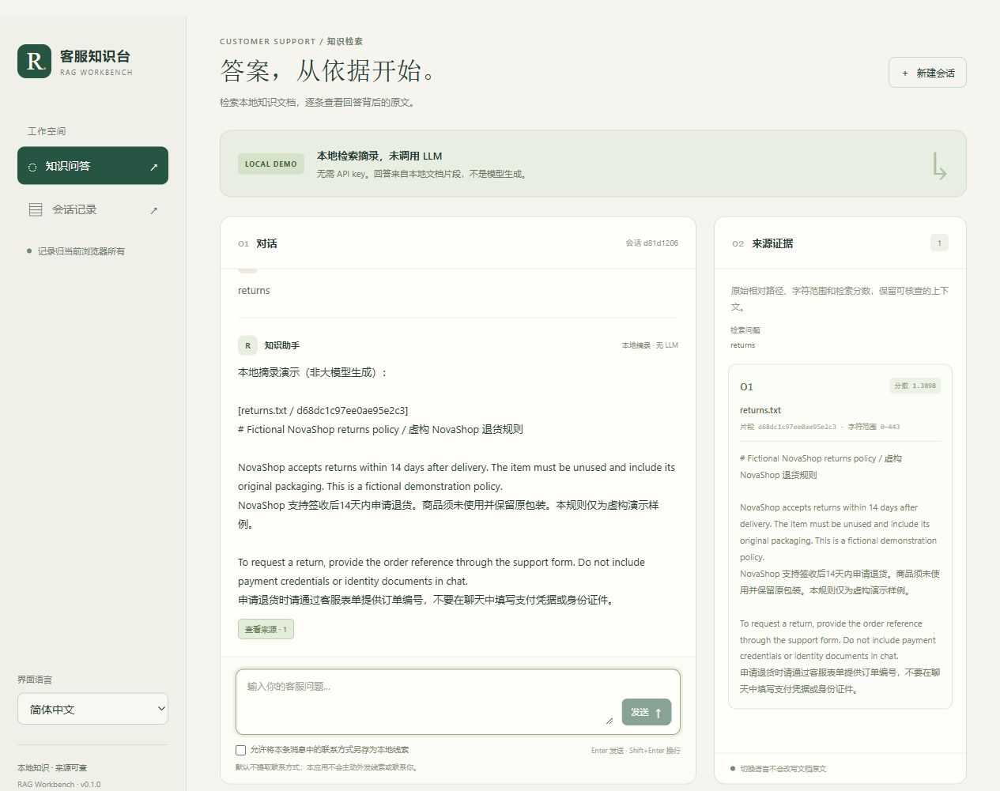

# Django RAG 客服知识台

简体中文 · [English](README.md)

面向本地文本文档的双语 Django 客服问答工作台。

默认模式提供真实的本地文档检索，**直接返回摘录，未调用 LLM**。每条来源显示相对文件路径、片段 ID、字符范围与分数。界面支持 English / 简体中文切换、当前浏览器的会话恢复/导出/删除，以及默认关闭的本地联系方式提取。



## 本地运行

需要 Python 3.11 或更新版本。以下命令在仓库根目录执行。

### Windows 便捷启动：无密钥演示

```powershell
.\run.ps1
```

如果 PowerShell 阻止执行脚本，可仅对本次进程使用：

```powershell
powershell -ExecutionPolicy Bypass -File .\run.ps1
```

脚本会在需要时创建 `.venv`，用 `pip install -e .` 安装基础运行依赖，执行数据库迁移、构建 **demo** 索引，然后在 [127.0.0.1:8000](http://127.0.0.1:8000/) 启动服务。`-Port` 默认 `8000`；换端口可用 `.\run.ps1 -Port 8010`。安装依赖时可能联网下载；演示运行本身不调用模型或网络。按 Ctrl+C 停止。

**此入口固定启动无密钥 demo**，即使私有 `.env` 中选择了 API 模式，也会以 demo 运行；不会安装开发/API/向量依赖组。其他模式使用下面的手动安装和 API 流程。

### 手动安装：所有平台

1. 创建并激活环境。Windows PowerShell：

   ```powershell
   python -m venv .venv
   .\.venv\Scripts\Activate.ps1
   ```

   macOS / Linux 使用 `source .venv/bin/activate` 激活。

2. 安装项目与开发依赖：

   ```powershell
   python -m pip install -e ".[dev]"
   ```

3. 初始化新的本地数据库并构建演示索引：

   ```powershell
   python manage.py migrate
   python manage.py build_index
   ```

4. 启动本地服务：

   ```powershell
   python manage.py runserver 127.0.0.1:8000
   ```

5. 打开[本地问答页](http://127.0.0.1:8000/)，输入“订单一般多久发货？”或“How do I request a return?”，查看右侧原文依据。侧栏可切换 **English / 简体中文**。

以上默认流程**不需要 `.env`、API key、模型下载或外部服务**。`DJANGO_DEBUG` 默认为 false；CSS 和 JavaScript 通过模板片段内嵌，不依赖开发静态文件服务、CDN或外部字体。

新建的 SQLite 数据库、开发用私密密钥和生成索引都位于 Git 忽略的 `.runtime/` 下。全新本地安装不含已有聊天记录。会话归当前浏览器的 Django cookie 所有；清除 cookie 后可能无法再次访问旧会话。这是本地浏览器归属隔离，不是账户体系或生产认证系统。

## 两种模式的边界

| | 默认 `demo` | 可选 `openai` |
|---|---|---|
| 检索 | 对真实文本片段做本地词项检索 | LangChain 兼容嵌入接口与本地 FAISS 相似度检索 |
| 回答 | 明确标示的文档原文摘录 | 有匹配依据时，调用配置的聊天模型 |
| 网络 | 无模型或网络请求 | 建索引时向提供方发送文档；问答时发送问题、有限上下文和检索片段 |
| 条件 | 基础安装即可 | 安装 `vector`、`api` 依赖组，自备服务、凭据和模型 |
| 真实提供方验证 | 不适用 | **本次集成未执行**；离线模拟不能证明真实服务兼容性或回答质量 |

提供方调用失败会明确返回错误，不会悄悄换成本地演示结果。没有命中时会明确说明没有依据。`grounded` 只表示是否检索到支持片段，不能证明 API 回答中的每个判断正确；检索分数用于排序，不是校准后的置信概率。

## 知识文档与配置

[内置示例文档](data/sample_docs/)描述中英双语的**虚构 NovaShop 客服规则**。它们是虚构演示数据，不是真实商家的承诺，也不含真实客户记录。

将自己有权使用的 UTF-8 `.txt`、`.md` 文档放进本地目录。需要改配置时，可将 `.env.example` 复制为私有 `.env`，设置 `RAG_DOCS_DIR`。`.env` 已被 Git 忽略。修改文档、切分参数或嵌入模型后重新构建：

```powershell
python manage.py build_index
```

已有索引与当前语料或参数不一致时，会拒绝静默复用。语料哈希和文件校验保证本地一致性，不能证明文档作者身份、内容真实性，也不能防御能够整体替换本地文件的攻击者。

| 环境变量 | 默认值 | 用途 |
|---|---|---|
| `RAG_BACKEND` | `demo` | `demo` 或 `openai` |
| `RAG_DOCS_DIR` | `data/sample_docs` | 本地知识目录 |
| `RAG_INDEX_DIR` | `.runtime/index` | 生成的索引和元数据目录 |
| `RAG_CHUNK_SIZE` / `RAG_CHUNK_OVERLAP` | `1000` / `200` | 按字符计的窗口长度与重叠长度 |
| `RAG_TOP_K` | `4` | 最多返回的片段数 |
| `RAG_MAX_QUESTION_CHARS` | `4000` | 服务端问题长度上限；界面也设有输入上限 |
| `RAG_REQUEST_TIMEOUT` | `30` | API 超时秒数 |
| `RAG_MIN_VECTOR_SCORE` | `0.15` | API 模式的向量相似度最低值 |
| `APP_RUNTIME_DIR` | `.runtime` | Django 本地数据库和开发密钥目录 |
| `DJANGO_DEBUG` | `0` | Django 调试开关 |
| `DJANGO_ALLOWED_HOSTS` | 本地主机名 | 主机名白名单 |
| `DJANGO_SECRET_KEY` | 开发环境本地生成私密值 | 非开发环境须主动提供私密密钥 |

进程环境变量优先于 `.env`。不要把私有语料、运行数据和凭据放进提交或公开导出文件。

## 可选 API 模式

此路径使用上面的手动流程，不使用 `run.ps1`，再接入 LangChain 的 OpenAI 兼容客户端和 FAISS。接口形状相似不代表所有提供方或模型都兼容。仓库不附带任何凭据，尚未执行真实提供方验证。

1. 安装可选依赖：

   ```powershell
   python -m pip install -e ".[vector,api]"
   ```

2. 在私有 `.env` 中设置 `RAG_BACKEND=openai`、`OPENAI_API_KEY`、`OPENAI_CHAT_MODEL`、`OPENAI_EMBEDDING_MODEL`。使用非默认兼容服务时再设置 `OPENAI_BASE_URL`；远程地址须用 HTTPS，本地服务可用 HTTP。不要把凭据放进 URL，也不要提交 `.env`。

3. **确认愿意把语料发给该提供方后**，再次运行 `python manage.py build_index`。这一步会调用嵌入接口；之后问答可能调用嵌入和生成接口，并产生提供方费用。只发送自己有权传输的文档和消息。

4. 重启服务，确认界面显示 **API 模式**。配置缺失或调用失败会继续显示错误，不会伪装成本地演示成功。

项目不加载 pickle。可选向量索引由本地生成的 `index.faiss`、JSON 片段与校验清单组成。运行目录属于可信本地状态，不要装入陌生人提供的索引。

## 会话、联系方式同意与隐私

- 已完成的用户和助手消息保存在本地应用数据库。历史接口仅允许当前 Django 浏览器会话访问自己的记录，没有全局公开会话列表。
- 联系方式勾选框**默认关闭**。勾选后，允许从本次请求中单独提取邮箱或中国大陆手机号形式的文本，按类型和值记录到本地并去重；不会发邮件、短信、拨号或把线索提交到外部系统。
- 不勾选只表示不另存联系方式，**不会抹除聊天消息中的联系方式**：普通聊天历史仍保存完整消息。API 模式下，消息里出现的联系方式也可能随消息发往你配置的模型服务，与是否另存线索无关。
- 负面反馈仅用明确关键词规则记录，不是模型情绪判断。
- 浏览器 localStorage **只保存 `lang`**；不保存消息、草稿、凭据、来源片段或联系人同意状态。切换语言保留当前内存中的对话、草稿、选中来源与勾选状态，不翻译文档原文。
- JSON 导出含聊天与来源片段，分享前应自行检查。删除会话会级联删除关联的本地消息、联系方式与反馈。

## 查看检索示例

命令行示例与网页共用文档切分和词项检索组件：

```powershell
python -m examples.manual_rag --question "退货期限是多少？ returns" --top-k 2
```

它展示真实的原文字符范围，并报告生成调用数为零，无需 API 服务即可检查检索步骤。

请在仓库根目录、已激活安装环境的情况下用模块形式运行，与 CI 命令保持一致。


## 工程结构与接口

| 路径 | 作用 |
|---|---|
| `rag_core/` | 共用文档、切分、词项检索、校验后的向量文件与可选提供方链路 |
| `chatbot_app/` | Django RAG 适配器、数据模型、隔离接口、管理命令与双语模板 |
| `chatbot_project/` | Django 配置与路由 |
| `examples/manual_rag.py` | 命令行检索示例 |
| `data/sample_docs/` | 新写的虚构语料 |
| `tests/` | 离线核心与 Django 回归测试 |
| `docs/` | 架构与验证记录 |

`POST /api/chat/` 接收 `{message, session_id?, lang?, store_contact?}`；成功结果含 `answer`、`sources`、`mode`、`retrieval_query`、`grounded`、`session_id`、`contact_recorded`、`feedback_recorded`。每条来源含 `source`、`chunk_id`、`start`、`end`、`text`、`score`。

`GET /api/sessions/` 返回自己的会话；`GET /api/sessions/<uuid>/` 恢复；`DELETE` 删除；`GET /api/sessions/<uuid>/export/` 导出 JSON。详情与导出将会话元信息置于顶层，并带 `messages` 数组。修改请求受 Django CSRF 保护；错误使用 `{error: {code, message}}` 和相应的非成功状态码。[架构说明](docs/ARCHITECTURE.md)给出了完整数据流和边界。

## 验证与成果解释

```powershell
python manage.py check
python -m pytest
python -m build
python scripts/check_wheel.py
```

实际执行的测试和安装包隔离运行结果见[验证记录](docs/VALIDATION.md)。

默认测试使用合成数据及需要时的提供方模拟，检查真实检索依据与范围、文件一致性、接口校验、CSRF 和浏览器归属，不消耗真实 API 额度。它们不能证明真实模型质量、对任意提示注入的防护能力、商用成熟度或生产部署安全。浏览器检查可依次执行：中英提问、保留未发送草稿切换语言、查看来源范围、在历史页恢复/导出/删除自己的会话。
