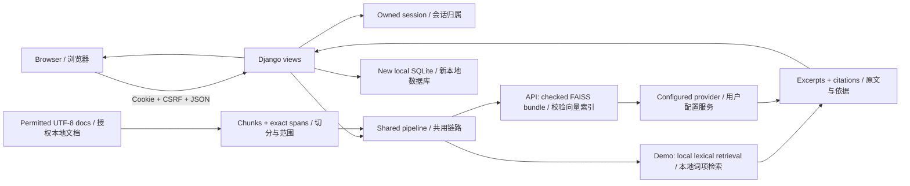

# Architecture / 架构

[English README](../README.md) · [中文说明](../README.zh-CN.md)

The system has one shared retrieval core and a thin Django application. The default route performs local lexical retrieval and returns labeled excerpts. Optional API mode supplies embeddings and generation through the configured OpenAI-compatible provider. These modes share evidence metadata, but make different network and quality claims.

系统采用共用检索核心与薄 Django 应用。默认只做本地词项检索并返回明确标识的原文；可选 API 模式通过用户配置的 OpenAI 兼容提供方获得嵌入和生成。两种模式共用来源元数据，但网络行为与能力边界不同。

## Module responsibilities / 模块职责

| Module / 模块 | Responsibility / 职责 |
|---|---|
| `rag_core/config.py` | Explicit environment configuration, bounds and optional provider requirements / 环境变量、范围约束与提供方配置 |
| `rag_core/documents.py` | UTF-8 `.txt`/`.md` loading, safe relative paths, corpus hashing and exact overlapping character windows / 文档加载、安全路径、语料哈希与字符重叠窗口 |
| `rag_core/lexical.py` | Deterministic local lexical ranking / 确定性的本地词项排序 |
| `rag_core/vector.py` | Optional FAISS retrieval plus checked JSON/manifest persistence / 可选 FAISS 检索与经校验的 JSON/清单持久化 |
| `rag_core/providers.py` | Explicit optional embeddings/chat client construction and bounded history / 显式可选模型客户端与有界历史 |
| `rag_core/pipeline.py` | Index building, retrieval, mode labeling and source-bearing answers / 建索引、检索、模式标识与携带来源的回答 |
| `chatbot_app/rag.py` | Django adapter for the shared retrieval pipeline / 共用检索链路的 Django 适配器 |
| `chatbot_app/models.py` | Owned conversations, messages, separately opted-in contacts and keyword feedback / 会话、消息、单独授权的联系方式与规则反馈 |
| `chatbot_app/views.py` | JSON validation, CSRF-compatible requests, ownership and record lifecycle / 请求校验、CSRF、归属与记录生命周期 |
| `chatbot_app/templates/` | Autoescaped templates, safe text-only dynamic rendering, bilingual labels and inline assets / 模板自动转义、动态纯文本渲染、双语标签与内嵌资源 |
| `examples/manual_rag.py` | Command-line retrieval example using the shared core / 共用核心的命令行检索示例 |

## Chat request lifecycle / 问答请求生命周期

1. The browser obtains a Django session and CSRF token from the page. UI language defaults to Chinese; localStorage may retain `lang` only.
2. A `POST /api/chat/` sends `message`, optional `session_id`, `lang` and a Boolean `store_contact`. The server checks content type, JSON shape, size, field types and session ownership. A client-supplied name does not choose an owner.
3. For an existing owned session, a bounded recent history is passed to the shared pipeline. Short follow-up queries may be combined with the previous user question by a transparent heuristic; `retrieval_query` exposes the query used. This is not semantic rewriting or a claim of robust dialogue understanding.
4. Demo mode retrieves real local chunks and formats excerpts. API mode checks configuration/index consistency, retrieves vectors, then generates with matching source context. No match returns an explicit no-evidence answer. Provider failures remain errors.
5. After a successful answer, one database transaction saves the user and assistant messages. Separate contact extraction occurs only when opted in; keyword feedback is local. Failed provider calls leave no successful business exchange.
6. The response contains the answer and sources. User, document, provider and stored history text are rendered via `textContent` or Django autoescaping. Retrieved or suspicious text does not acquire control privileges.

1. 页面建立 Django 会话并提供 CSRF token；默认中文，localStorage 只可保留 `lang`。
2. 浏览器发送问题、可选会话 ID、语言和布尔同意值；服务端检查 JSON、大小、字段类型与会话归属，不能用自报姓名选择他人记录。
3. 只传入有限近期历史；简短追问可能通过公开规则拼接上一问题，并用 `retrieval_query` 显示实际检索词。这不是语义改写或健壮对话理解证明。
4. 演示模式格式化真实命中文本；API 模式检查配置、索引、向量检索后再生成。无匹配明确说明；失败继续报错。
5. 成功后在事务中保存消息；只有主动勾选才另存本地联系方式，关键词反馈也只在本地。提供方失败不保存一轮成功业务消息。
6. 返回回答和来源；所有外来文本都按文本渲染，文档中的指令不因此获得应用权限。

## Evidence and index contracts / 证据与索引约定

A source is `{source, chunk_id, start, end, text, score}`. `source` is relative to the configured corpus root. `start` is inclusive and `end` exclusive, measured in Python Unicode characters after UTF-8/BOM decoding, not bytes. Therefore `document_text[start:end] == text`. `chunk_id` identifies the path/span, and the corpus hash separately detects content changes. The UI displays all of these fields; language switching does not translate snippets or alter numeric scores.

来源字段为 `{source, chunk_id, start, end, text, score}`。`source` 相对知识目录；UTF-8/BOM 解码后，`start` 含起点、`end` 不含终点，按 Python Unicode 字符而非字节计，因此 `document_text[start:end] == text`。`chunk_id` 标识路径/范围，另用语料哈希检测内容变化。界面展示原始来源，不随语言切换改写片段或分数。

Chunk size and overlap are validated before use. Demo lexical scores and vector cosine-style scores are different ranking signals; neither is a probability. `grounded=true` reports source availability, not factual entailment or a guarantee against hallucinations.

切分长度与重叠先校验；词项分数和向量相似度属于不同排序信号，都不是概率。`grounded=true` 表示有来源，不证明逻辑蕴含，也不保证模型没有幻觉。

Generated persistence is under `.runtime/index` by default. The bundle uses JSON metadata and a manifest, with optional `index.faiss`, rather than pickle. Corpus hashes, backend/model and chunk settings must match when loading. A stale or malformed bundle is rejected. These checks detect inconsistency under a trusted local-directory assumption; an attacker able to replace both data and its manifest can also replace their hashes. They are not signatures, access control or a complete poisoning defense.

持久化默认位于 `.runtime/index`，包含 JSON、清单与可选 `index.faiss`，不使用 pickle。加载时须匹配语料哈希、后端/模型与切分参数；过期或损坏文件会拒绝加载。检查依赖本地目录可信：能够同时替换数据和清单的人也能换哈希，因此它不是数字签名、访问控制或完整投毒防御。

## Web API / 网页接口

| Route / 路由 | Method / 方法 | Result / 结果 |
|---|---|---|
| `/` | GET | Bilingual chat page / 双语问答页 |
| `/sessions/` | GET | Owned conversation page / 自有会话页 |
| `/api/chat/` | POST | Pipeline result + `session_id`, `contact_recorded`, `feedback_recorded` |
| `/api/sessions/` | GET | `{sessions: [...]}`; owned sessions only / 仅返回自有会话 |
| `/api/sessions/<uuid>/` | GET | Top-level session metadata and `messages` / 顶层会话信息与消息 |
| `/api/sessions/<uuid>/` | DELETE | `{deleted: true, session_id}`; cascade local related records / 级联删除本地关联记录 |
| `/api/sessions/<uuid>/export/` | GET | Owned conversation JSON; no contact table values / 自有会话 JSON，不含独立联系方式表值 |
| `/api/health/` | GET | Process health and configured backend, not provider connectivity / 进程状态与后端配置，不验证提供方连通性 |

Session list fields: `session_id`, `user`, `created_at`, `updated_at`, `message_count`, `preview`. Detail/export adds `messages`, each with `id`, `role`, `content`, `sources`, `mode`, `created_at`. Timestamps use ISO 8601 in the API and local formatting in the UI. `user` is a legacy descriptive field, not an authorization credential.

会话列表字段如上；详情/导出增加消息数组。接口时间为 ISO 8601，界面按语言显示。`user` 是保留的描述字段，不是权限凭据。

Errors use `{error: {code, message}}`: invalid input is 400, CSRF failure 403, unavailable owned session 404, wrong method 405, oversized request 413, and retrieval/provider failure 503. The UI maps codes to Chinese/English messages and does not expose provider exception internals. There is no automatic retry of a chat POST, which could otherwise duplicate a successful but interrupted exchange.

错误统一携带 code/message 与相应状态码；界面映射中英文本，不显示提供方异常内部信息。聊天 POST 不自动重试，避免成功但响应中断时重复写入。

## Privacy and trust boundaries / 隐私与信任边界

- Browser ownership depends on retaining the Django session cookie. It does not provide identity verification, shared-device privacy, a multi-tenant account system or protection after browser compromise.
- The contact checkbox controls a **separate Contact record**, not retention or redaction of the full message. API-mode messages/context/snippets reach the configured provider even if contact capture is off.
- The app has no email, SMS, workflow automation or external lead-submission capability. Optional model requests are still external transmission.
- `lang` is the only localStorage key used. Drafts and UI consent remain in memory; chat history remains in the application database.
- No arbitrary HTML/Markdown from messages is rendered as executable markup. Index manifests do not grant source documents permissions. Provider prompting is not a proof of prompt-injection resistance.

- cookie 归属不等于身份认证，不能保证共用设备隐私或浏览器被控制后的安全。
- 联系方式勾选只控制独立 Contact 记录，不控制完整消息保存；API 模式仍向配置提供方传输消息、上下文与片段。
- 本应用没有邮件、短信、工作流自动化和外部线索提交能力，但可选模型请求仍属于外发。
- localStorage 只保存语言；草稿与界面同意留在内存，历史留在应用数据库。
- 不把消息 Markdown/HTML 作为可执行页面内容；来源文本和清单不赋予权限，提示约束也不证明抗注入。

## Validation limits / 验证边界

Use `python manage.py check`, `python -m pytest`, `python -m build` and the browser workflow in the READMEs. Offline tests can establish concrete retrieval spans, mode behavior, index consistency, validation, CSRF and ownership for the tested cases. Optional provider calls are mocked; live provider/model compatibility, answer quality and deployment security remain unverified by those tests. The interface is a local application; these checks do not establish production deployment readiness.

运行 README 中的检查、测试、构建与浏览器流程。离线测试只能支持所测用例下的范围、模式、索引、请求、CSRF与归属行为；模拟提供方不能证明真实模型兼容性、回答质量或部署安全。本项目是本地应用，这些检查不代表已经达到生产部署要求。
